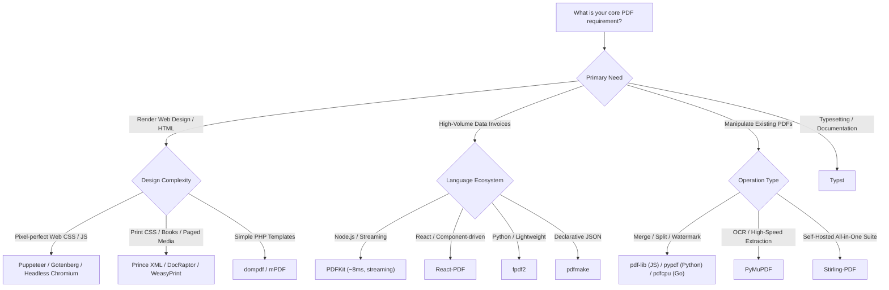

# 📄 Awesome PDF Generation &amp; Manipulation

  

  
  
  
  
  
  

---

## 📌 Executive Summary &amp; Overview

**Awesome PDF Generation &amp; Manipulation** is the definitive, search-optimized collection of software libraries, hosted developer APIs, and open-source engines dedicated to programmatic document construction, HTML-to-PDF rendering, and PDF file transformation.

Whether you need to generate high-throughput invoices in Node.js (sub-10ms), render pixel-perfect CSS Paged Media reports in Python, export client-side dashboards in the browser, or automate complex server-side PDF splitting, merging, OCR, and digital signatures, this guide covers the entire programmatic PDF ecosystem.

---

## 📑 Table of Contents

- [🌐 Sector Overview &amp; Market Dynamics](#-sector-overview--market-dynamics)
- [🏢 SaaS &amp; Commercial Hosted Platforms](#-saas--commercial-hosted-platforms)
- [🚀 Open-Source GitHub Projects](#-open-source-github-projects)
  - [📊 Quick Comparison Matrix](#-quick-comparison-matrix)
  - [🔍 Detailed Project Breakdowns (Ranked by Stars)](#-detailed-project-breakdowns-ranked-by-stars)
- [🎯 Architectural Selection Guide](#-architectural-selection-guide)
- [🤝 How to Contribute](#-how-to-contribute)
- [📈 Star History](#--star-history)
- [💖 Support](#-support)
- [⚖️ Disclaimer &amp; License](#️-disclaimer--license)

---

## 🌐 Sector Overview &amp; Market Dynamics

The global document generation and automation software market is currently valued at approximately **$3.6B to $4.8B**, projected to surge past **$10B by 2032** at an estimated CAGR of 11.8% to 14.2%. Growth is propelled by accelerating enterprise digital transformation, automated e-invoicing mandates, dynamic contract assembly, and automated business reporting pipelines.

The sector exhibits **moderate fragmentation**: while legacy desktop publishing and enterprise PDF standardization remain heavily concentrated under category pioneers like Adobe, the modern developer-centric API and programmatic PDF generation ecosystem is broadly fragmented. Developers choose between high-end commercial cloud APIs (Prince XML, DocRaptor, Apryse, Aspose), lightweight hosted SaaS endpoints (PDFShift, PDFMonkey), and a rich self-hosted open-source ecosystem spanning headless Chromium automation (Puppeteer, Gotenberg), declarative frameworks (Typst, React-PDF), and native zero-dependency drawing engines (PDFKit, pypdf, fpdf2).

---

## 🏢 SaaS &amp; Commercial Hosted Platforms

The table below compiles leading commercial PDF platforms and hosted rendering APIs, **sorted descending by company scale (valuation / annual revenue)**.

| 🏢 Product &amp; Vendor | 📊 Company Scale (Valuation / Revenue) | 💰 Starting Tier Price | 🎁 Free Tier / Trial Limits | 🎯 Core Strengths &amp; Target Use Case |
| :--- | :--- | :--- | :--- | :--- |
| **[Adobe PDF Services API](https://developer.adobe.com/document-services/apis/pdf-services/)** | ~$215B Market Cap (NASDAQ: ADBE) / ~$21.4B Annual Revenue | **$0.05 / transaction** (volume enterprise packages via Adobe Sales; starter agreements from ~$1,000/yr) | **500 Document Transactions / month** forever free; no credit card required; low-volume production permitted | Cloud-native Word/HTML-to-PDF, OCR extraction, PDF/A compliance, and digital signing by the creator of the PDF format. Enterprise-grade reliability. |
| **[Apryse (formerly PDFTron)](https://apryse.com/)** | ~$1.5B Valuation (Thoma Bravo / Silversmith) / ~$100M+ ARR | **$1,500 / year** (Server SDK base license tier; modular pricing tailored to deployment) | **40 active days evaluation trial** with full feature access across all SDK modules (output watermarked after evaluation period) | Enterprise cross-platform SDK for web, desktop, and mobile. Supports high-performance viewing, annotation, form fields, redaction, digital signatures, and CAD/BIM rendering. |
| **[Aspose.PDF](https://products.aspose.com/pdf/)** | ~$35M ARR (Aspose Pty Ltd / GroupDocs) | **$1,679 one-time** (Developer Small Business license: 1 developer, 1 deployment site, 1-year updates) | **Indefinite free evaluation** (capped at processing 4 items per collection, e.g., max 4 pages/fields, with watermark) or **30-day unrestricted temporary license** on business email request | Extensive standalone native APIs for .NET, Java, Python, C++, and Android. Total programmatic control over PDF generation, conversion, encryption, and PDF/A validation without third-party dependencies. |
| **[IronPDF](https://ironsoftware.com/csharp/pdf/)** | ~$20M ARR (Iron Software) | **$999 one-time** (Lite Perpetual License: 1 developer, 1 location, 1 project with 1-year support) | **30-day fully functional free trial key** (unlimited document generation with zero watermarks during trial; no credit card required) | Developer-friendly HTML-to-PDF rendering engine for .NET, Java, Python, and Node.js with pixel-accurate CSS3, JavaScript execution, and integrated PDF editing. |
| **[Prince XML](https://www.princexml.com/)** | ~$7M ARR (YesLogic Pty Ltd) | **$495 one-time** (Desktop single-user license) / **$3,800 one-time** (Server single-CPU license with 1-year upgrades) | **Free non-commercial desktop license forever** (full CSS Paged Media functionality; small Prince logo watermark on page 1) | The gold standard HTML/CSS-to-PDF publishing engine. Unequaled CSS Paged Media implementation, complex multi-column layouts, footnotes, and CMYK printing profiles. |
| **[DocRaptor](https://docraptor.com/)** | ~$4M ARR (Expected Behavior, LLC) | **$15 / month** (Basic Plan: 125 documents/month included; $0.12 per additional document) | **5 production documents / month forever free** + **unlimited watermarked test documents** on all plans | Managed cloud API wrapper powered directly by the Prince XML engine. Delivers print-CSS fidelity without managing server hardware or expensive server licenses. |
| **[PDFShift](https://pdfshift.io/)** | ~$1.5M ARR (PDFShift) | **$9.00 / month** (Starter Plan: 250 document credits/month; $0.04 per overage conversion) | **50 free credits / month forever** (credits reset monthly; no credit card required; 1 credit per 5MB output) | Low-latency REST API using headless Chromium for converting modern web pages (CSS Grid, Flexbox, Web Fonts) to PDF with built-in webhook callbacks and S3 storage delivery. |
| **[PDFMonkey](https://www.pdfmonkey.io/)** | ~$1.0M ARR (PDFMonkey) | **€5.00 / month** (~$5.50/mo for Starter: 100 documents/mo; Pro Plan starts at €15/month for 500 documents) | **20 documents / month forever free** (1-day retention) + automatic **30-day Pro Trial** with 300 free documents on signup | Visual template builder combining HTML/CSS and Liquid dynamic templating. Built-in integrations for Zapier, Make, and webhook triggers. |

---

## 🚀 Open-Source GitHub Projects

Open-source libraries offer complete infrastructure independence, zero per-document licensing costs, and complete privacy control.

### 📊 Quick Comparison Matrix

The table below summarizes the top open-source projects, **sorted descending by GitHub star count**.

| Rank | Project Name | GitHub Stars Badge | Language / Ecosystem | License | Primary Architecture |
| :---: | :--- | :--- | :--- | :--- | :--- |
| 1 | **Puppeteer** |  | Node.js / Chromium | Apache-2.0 | Headless Chrome Print Pipeline |
| 2 | **Stirling-PDF** |  | Java / Spring Boot | GPL-3.0 / MIT | Self-Hosted Web PDF Swiss Army Knife |
| 3 | **Typst** |  | Rust | Apache-2.0 | Next-Gen Markup &amp; Typesetting Engine |
| 4 | **jsPDF** |  | JavaScript (Browser/Node) | MIT | Client-Side Vector &amp; HTML Canvas |
| 5 | **React-PDF** |  | React / TypeScript | MIT | Declarative React Component Renderer |
| 6 | **wkhtmltopdf** |  | C++ / QtWebKit | LGPL-3.0 | CLI HTML-to-PDF WebKit Renderer |
| 7 | **Gotenberg** |  | Go / Docker | MIT | Stateless Microservice (Chromium/LibreOffice) |
| 8 | **pdfmake** |  | JavaScript | MIT | Declarative JSON Document Layout |
| 9 | **dompdf** |  | PHP | LGPL-2.1 | Pure PHP CSS 2.1 Layout Engine |
| 10 | **PyMuPDF** |  | Python / C (MuPDF) | AGPL-3.0 | Ultra-Fast Parsing, Extraction &amp; Editing |
| 11 | **PDFKit** |  | JavaScript / Node.js | MIT | Stream-Based Coordinate Drawing Engine |
| 12 | **pypdf** |  | Python | BSD-3-Clause | Pure Python Page &amp; Document Manipulation |
| 13 | **WeasyPrint** |  | Python | BSD-3-Clause | Dedicated Print CSS &amp; Paged Media Engine |
| 14 | **pdfcpu** |  | Go | Apache-2.0 | Pure Go PDF Processor &amp; CLI |
| 15 | **pdf-lib** |  | TypeScript / JS | MIT | Zero-Dependency Creation &amp; Modification |
| 16 | **mPDF** |  | PHP | GPL-2.0 | Comprehensive UTF-8 &amp; CSS3 PHP Engine |
| 17 | **TCPDF** |  | PHP | LGPL-3.0 | Legacy Single-Class PHP PDF Suite |
| 18 | **fpdf2** |  | Python | LGPL-3.0 | Lightweight Python Primitive Drawing |

---

### 🔍 Detailed Project Breakdowns (Ranked by Stars)

#### 1. [Puppeteer](https://github.com/puppeteer/puppeteer) 
- **Ecosystem:** Node.js / Chromium (Apache-2.0)
- **Key Characteristics:** Headless Chrome PDF rendering via `page.pdf()`. Faithfully renders modern web technologies (Flexbox, CSS Grid, SVG, Canvas, WebGL, custom web fonts) via Chromium's native print pipeline.
- **Performance Profile:** Browser process startup incurs ~800ms overhead; however, reusing a persistent pool of browser instances drops per-page generation latency to **~25ms**.
- **Best For:** Complex dashboards, data visualizations, and applications where the PDF must mirror an existing web frontend pixel-for-pixel.

#### 2. [Stirling-PDF](https://github.com/Stirling-Tools/Stirling-PDF) 
- **Ecosystem:** Java / Spring Boot / Docker (GPL-3.0 / MIT)
- **Key Characteristics:** Powerful, locally hosted web application and REST API for PDF manipulation. Provides end-to-end functionality including merging, splitting, rotating, cropping, compressing, OCR text extraction, watermarking, password removal, and PDF/A conversion.
- **Privacy &amp; Security:** 100% private and on-premise; zero telemetry or outbound document transmission.
- **Best For:** Teams and enterprises seeking a self-hosted replacement for commercial online tools like Smallpdf or iLovePDF.

#### 3. [Typst](https://github.com/typst/typst) 
- **Ecosystem:** Rust (Apache-2.0)
- **Key Characteristics:** A revolutionary markup-based typesetting system designed as a modern, high-speed alternative to LaTeX. Features an intuitive syntax, built-in layout functions, instant incremental compilation, and expressive scripting.
- **Performance Profile:** Sub-millisecond incremental rendering speed; generates publication-grade PDFs with advanced math formulas and typographic control.
- **Best For:** Technical documentation, academic papers, scientific reports, and programmatic document generation from markdown-like syntax.

#### 4. [jsPDF](https://github.com/parallax/jsPDF) 
- **Ecosystem:** JavaScript / Browser &amp; Node.js (MIT)
- **Key Characteristics:** The industry standard client-side PDF generation library. Creates PDFs entirely in the client browser without round-trips to backend servers.
- **Implementation Nuances:** Supports coordinate-based vector primitives and an `html()` method (backed by html2canvas and DOMPurify). Full UTF-8 support requires embedding custom TTF font files via its fontconverter utility.
- **Best For:** Client-side "Download Receipt", ticket generation, and single-page web export buttons.

#### 5. [React-PDF](https://github.com/diegomura/react-pdf) 
- **Ecosystem:** React / TypeScript (MIT)
- **Key Characteristics:** Custom React reconciler for rendering PDF documents using standard React JSX syntax (`<Document>`, `<Page>`, `<View>`, `<Text>`). Runs seamlessly on both the client browser and Node.js server.
- **Styling Model:** Uses a Flexbox-based layout engine powered by Yoga, allowing frontend engineers to style documents with familiar CSS properties.
- **Best For:** React and Next.js applications needing reusable, component-driven PDF templates and dynamic live-preview generation.

#### 6. [wkhtmltopdf](https://github.com/wkhtmltopdf/wkhtmltopdf) 
- **Ecosystem:** C++ / QtWebKit (LGPL-3.0)
- **Key Characteristics:** Classic command-line utility to convert HTML into PDF using the WebKit rendering engine. Historically the most popular server-side converter.
- **Current Status:** Archived/maintenance mode due to outdated WebKit engine limitations, but still extensively deployed in legacy production environments.
- **Best For:** Existing server architectures maintaining established wkhtmltopdf wrapper scripts.

#### 7. [Gotenberg](https://github.com/gotenberg/gotenberg) 
- **Ecosystem:** Go / Docker (MIT)
- **Key Characteristics:** A stateless Docker-powered REST API microservice orchestrating Chromium, LibreOffice, and PDFtk. Seamlessly converts HTML, Markdown, Word, Excel, and PowerPoint documents into pristine PDFs.
- **Architecture:** Features built-in health checks, process isolation, clustering support, and asynchronous webhook delivery.
- **Best For:** Microservice and polyglot architectures requiring centralized, scalable document conversion endpoints.

#### 8. [pdfmake](https://github.com/bpampuch/pdfmake) 
- **Ecosystem:** JavaScript / Browser &amp; Node.js (MIT)
- **Key Characteristics:** Declarative JSON-based document definition engine. You construct documents as structured JSON objects rather than imperative coordinate drawing calls.
- **Capabilities:** Built-in auto-pagination, dynamic multi-page tables, column layouts, text styling, and embedded virtual file system (VFS) fonts.
- **Best For:** Data-dense corporate reports, invoice tables, and structured business documents requiring consistent typography across client and server.

#### 9. [dompdf](https://github.com/dompdf/dompdf) 
- **Ecosystem:** PHP (LGPL-2.1)
- **Key Characteristics:** Pure PHP HTML-to-PDF converter. Reads HTML and CSS 2.1 stylesheets and produces standard PDF documents without external binaries or browser dependencies.
- **Best For:** Shared PHP hosting environments, WordPress plugins, and standard Laravel/Symfony invoice generation pipelines.

#### 10. [PyMuPDF](https://github.com/pymupdf/PyMuPDF) 
- **Ecosystem:** Python / C (AGPL-3.0)
- **Key Characteristics:** High-performance Python bindings for MuPDF. Known for blazingly fast PDF parsing, high-resolution rasterization, text extraction, redaction, and OCR integration via Tesseract.
- **Best For:** AI/LLM document preprocessing, page extraction, high-speed document search, and programmatic page transformation.

#### 11. [PDFKit](https://github.com/foliojs/pdfkit) 
- **Ecosystem:** JavaScript / Node.js (MIT)
- **Key Characteristics:** High-speed server-side coordinate drawing library with zero browser or native C++ dependencies. Generates simple invoices in **~8ms per document**.
- **Architecture:** Implements Node.js Readable streams, allowing generated pages to be piped directly into HTTP response streams or cloud storage buckets without buffering in memory.
- **Best For:** Massive-volume, latency-critical billing and invoice generation systems.

#### 12. [pypdf](https://github.com/py-pdf/pypdf) 
- **Ecosystem:** Python (BSD-3-Clause)
- **Key Characteristics:** Pure Python library for splitting, merging, cropping, rotating, encrypting, and decrypting existing PDF documents.
- **Best For:** Python automated workflows, batch document assembly, and metadata extraction without heavy binary dependencies.

#### 13. [WeasyPrint](https://github.com/Kozea/WeasyPrint) 
- **Ecosystem:** Python (BSD-3-Clause)
- **Key Characteristics:** Visual rendering engine written in Python for converting HTML and CSS into print-ready PDF pages. Specifically engineered for CSS Paged Media standards (headers, footers, page counters, bleed, and crop marks).
- **Best For:** Python backends generating styled multi-page books, invoices, and statistical reports without a headless browser dependency.

#### 14. [pdfcpu](https://github.com/pdfcpu/pdfcpu) 
- **Ecosystem:** Go (Apache-2.0)
- **Key Characteristics:** Ultra-fast, pure Go PDF processing engine and CLI. Handles merging, splitting, watermarking, stamping, trimming, form extraction, and document validation.
- **Best For:** Cloud-native Go microservices and command-line automation pipelines requiring zero external dependencies.

#### 15. [pdf-lib](https://github.com/Hopding/pdf-lib) 
- **Ecosystem:** TypeScript / JavaScript (MIT)
- **Key Characteristics:** Pure TypeScript library for creating and modifying PDF documents in any JavaScript runtime (Node.js, Deno, Bun, React Native, and web browsers).
- **Capabilities:** Excellent for form filling, page merging/splitting, embedding vector paths, and stamping watermarks.
- **Best For:** Universal JavaScript environments requiring document manipulation without native binaries.

#### 16. [mPDF](https://github.com/mpdf/mpdf) 
- **Ecosystem:** PHP (GPL-2.0)
- **Key Characteristics:** PHP library based on FPDF and HTML2FPDF with expansive CSS3 support, full UTF-8 Unicode compatibility, bidirectional text shaping (Arabic/Hebrew), and barcode generation.
- **Best For:** Internationalized PHP web applications requiring right-to-left (RTL) scripts and complex tables.

#### 17. [TCPDF](https://github.com/tecnickcom/TCPDF) 
- **Ecosystem:** PHP (LGPL-3.0)
- **Key Characteristics:** Classic single-class PHP PDF generator with broad 1D/2D barcode support, digital signatures, and PDF/A compliance. (Note: maintained primarily for legacy systems; tc-lib-pdf is the modern successor).
- **Best For:** Legacy PHP systems maintaining established reporting modules.

#### 18. [fpdf2](https://github.com/py-pdf/fpdf2) 
- **Ecosystem:** Python (LGPL-3.0)
- **Key Characteristics:** Modern, lightweight successor to PyFPDF. Features automatic Unicode (UTF-8) font subset embedding, table formatting, Markdown-like syntax, and chart embedding from Matplotlib and Pandas.
- **Best For:** Lightweight Python scripts, CS education (used at Harvard CS50), and quick automated data exports.

---

## 🎯 Architectural Selection Guide

Choosing the optimal PDF generation or manipulation stack depends on three primary factors: **fidelity requirements**, **throughput constraints**, and **infrastructure tolerance**.

### ⚡ Performance &amp; Infrastructure Matrix

- **Coordinate-Based Drawing (PDFKit, fpdf2):**
  - *Speed:* ⚡ ~8ms per document.
  - *Memory:* Minimal (~20–40 MB).
  - *Trade-off:* Prohibitive layout design cost; must calculate coordinates and line breaks manually.
- **Headless Chromium (Puppeteer, Gotenberg):**
  - *Speed:* ⏱️ ~800ms initial startup; ~25ms per page with persistent warm browser pools.
  - *Memory:* Heavy (~300–600 MB per browser instance).
  - *Trade-off:* High design fidelity with modern CSS Grid/Flexbox, but requires robust worker queue architecture.
- **Dedicated Print Renderers (Prince XML, WeasyPrint):**
  - *Speed:* ⏱️ ~150–400ms per document.
  - *Memory:* Moderate (~80–180 MB).
  - *Trade-off:* Unmatched CSS Paged Media support for books and multi-page formal reports; lacks full interactive browser JS runtime.

---

## 🤝 How to Contribute

Contributions from the developer community are warmly welcomed! To suggest a new open-source library, SaaS platform, or performance benchmark:

1. 🍴 **Fork the repository** on GitHub.
2. 🌿 **Create a descriptive feature branch** (`git checkout -b add-my-tool`).
3. 📝 **Edit `README.md`**: Follow existing table and list formatting. Include verified pricing, free tier limits, star badges, and factual architectural characteristics.
4. 🔍 **Verify links and badges**: Ensure all markdown links, stargazers badges, and anchors resolve properly.
5. 🚀 **Submit a Pull Request** with a concise description of your additions.

---

##  Star History

---

## 💖 Support

If you find this curated resource helpful for your projects, architecture decisions, or engineering workflows, please consider supporting the project:

- ⭐ **Star this repository** to help other engineers discover it.
- 🍴 **Fork and contribute** your tools, fixes, and insights.
- 📣 **Share with your network** on Twitter/X, LinkedIn, Reddit, and Discord.
- ☕ **Sponsor the Maintainer:** If you'd like to fuel ongoing curation, benchmarking, and updates, you can buy me a coffee via the **[GitHub Sponsors Dashboard](https://github.com/sponsors/ishandutta2007)**.

Thank you to all contributors and stargazers across the open-source community! 🙌

---

## ⚖️ Disclaimer &amp; License

- This repository is an independent, community-curated technical index and does not represent a commercial endorsement of any product or service.
- Product names, logos, and brands are property of their respective owners. Performance metrics and pricing tiers are subject to change by vendors; always consult official documentation for production deployments.
- Distributed under the [MIT License](LICENSE). Built with ❤️ for backend developers, frontend engineers, and document automation teams worldwide.
